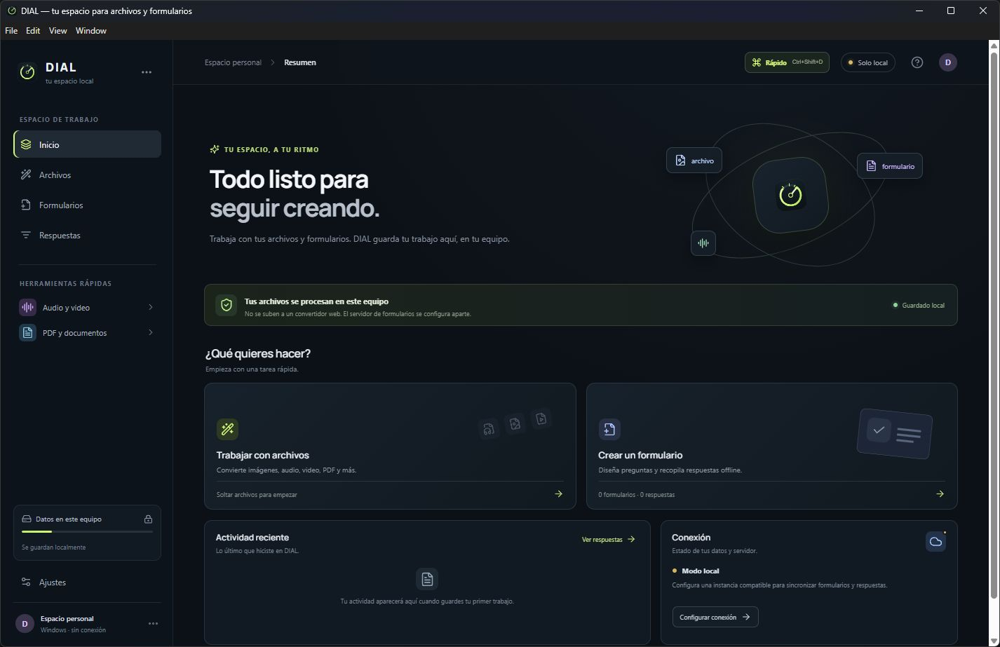
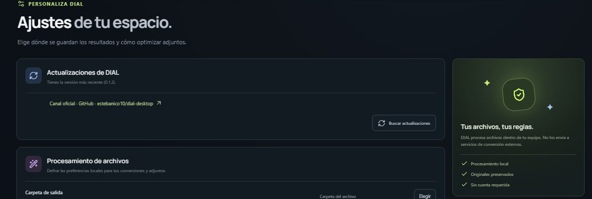

# DIAL para Windows

**Archivos, medios y formularios en un espacio de trabajo local.** DIAL reúne herramientas cotidianas en una aplicación de escritorio: trabaja con tus archivos en este equipo, organiza tareas por lotes y guarda formularios y respuestas sin exigir una cuenta.

[Descargar la última versión](https://github.com/estebanico10/dial-desktop/releases/latest) · [Ver todas las versiones](https://github.com/estebanico10/dial-desktop/releases) · [Informar un problema](https://github.com/estebanico10/dial-desktop/issues)



*Captura de la aplicación para Windows, versión 0.1.2. La captura no contiene datos personales.*



*Ajustes muestra el canal oficial de DIAL y el control para buscar una actualización.*

## Qué puedes hacer

### Convertir y preparar archivos

- Convertir imágenes entre PNG, JPEG, WebP, AVIF y TIFF, o exportarlas a PDF; redimensionar, girar, recortar y ajustar color.
- Crear collages de 2 a 20 imágenes con columnas, separación, tamaño de cuadros y fondo configurables.
- Convertir audio y video con FFmpeg incluido: cambiar formato o velocidad, recortar, normalizar, ajustar volumen, aplicar fundidos, quitar audio, capturar fotogramas y dividir o unir clips compatibles.
- Organizar, unir o dividir PDF. El organizador muestra miniaturas para seleccionar y reordenar páginas antes de exportar.
- Convertir CSV ↔ XLSX, DOCX → HTML, TXT ↔ Markdown y SRT ↔ VTT; crear o extraer archivos ZIP.
- Procesar varios archivos en una cola local, consultar el historial y volver a intentar trabajos interrumpidos con sus ajustes.

Las herramientas disponibles dependen del tipo de archivo. No se ofrecen los 275 pares de conversión anunciados por el producto de referencia.

### Formularios y respuestas sin conexión

- Diseñar formularios locales con campos de texto, número, opciones, sí/no, fecha y adjuntos.
- Mostrar preguntas condicionales; las respuestas exportadas incluyen los campos que estaban visibles.
- Guardar formularios, respuestas y adjuntos en este equipo, y exportar respuestas a CSV o XLSX.

### Acceso rápido en Windows

- Abrir el modo rápido con **Ctrl + Shift + D**, o elegir archivos y carpetas desde la aplicación.
- Arrastrar y soltar, analizar hasta 5.000 archivos y ver un resumen por tipo.
- Crear ZIP conservando las rutas, comprimir medios compatibles, abrir las herramientas completas o revelar un resultado en el Explorador.
- Usar el menú contextual **Analizar con DIAL** para abrir archivos o carpetas con la aplicación.

## Descargas y actualizaciones

La versión publicada se distribuye en [GitHub Releases](https://github.com/estebanico10/dial-desktop/releases). En Windows, abre **Ajustes → Actualizaciones de DIAL** para consultar el canal oficial o buscar una versión. La app también comprueba el canal al iniciar; si descarga una actualización, permite reiniciar e instalarla conservando los datos locales.

El canal configurado apunta a `estebanico10/dial-desktop`. La Release 0.1.2 y su feed están publicados; la instalación actual 0.1.2 muestra que está al día. **Aún falta validar una actualización real desde una instalación anterior a una versión nueva.**

## Privacidad y estado de la integración

- Las conversiones se ejecutan en este equipo; DIAL no sube los archivos a un servicio de conversión web.
- Formularios, respuestas y adjuntos se guardan bajo `%APPDATA%/dial-desktop/DIAL`.
- La conexión con un servidor se puede configurar, pero la réplica con el protocolo de Tangerine todavía no está implementada. El botón de sincronización indica que la integración está pendiente y no envía las respuestas.
- El envío directo a Blip también está pendiente.

DIAL ofrece herramientas locales relacionadas con Tangerine, pero **no incluye Tangerine completo**: no inicia ni empaqueta el servidor ni CouchDB, y su editor local no es el editor Angular original.

## Instalar y desarrollar

La descarga para usuarios está en [la página de la última Release](https://github.com/estebanico10/dial-desktop/releases/latest). DIAL está dirigido a Windows x64.

Para ejecutar desde el código fuente se requiere Node.js 22 o posterior:

```powershell
npm install
npm run dev
```

Para crear un instalador local de Windows:

```powershell
npm run dist:win
```

El instalador se genera en `release/`. Una compilación local no publica una Release de GitHub.

## Licencia y procedencia

Este módulo se distribuye bajo **GPL-3.0-only**. Consulta [`COPYING`](COPYING) y [`UPSTREAM-NOTICE.md`](UPSTREAM-NOTICE.md) para la licencia y la procedencia del código comunitario de Tangerine.
